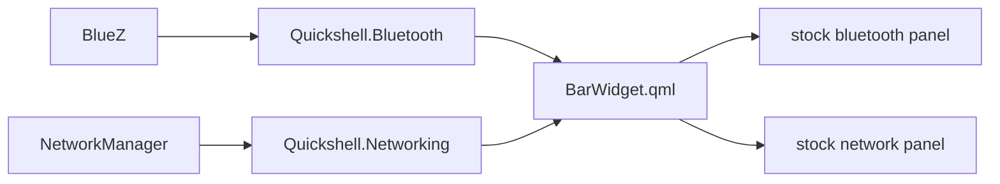

<p align="center">
  <picture>
    <source media="(prefers-color-scheme: dark)" srcset="assets/brand/lockup-dark.svg">
    
  </picture>
</p>

<p align="center"><strong>Bluetooth and Wi-Fi side by side in one Omarchy bar widget.</strong></p>

<!-- Logo is a proposal pending owner sign-off. TODO: replace preview.png (a listing mock-up) with a real screenshot from a live Omarchy session. -->

A compact Omarchy bar widget that shows Bluetooth and Wi-Fi state side by side — dual icons with per-radio toggle controls and status-at-a-glance coloring.

## Install

```bash
omarchy plugin add https://github.com/duketopceo/omarchy-connections
omarchy plugin enable lukedaduke.connections
```

## Features

- Combined Bluetooth + Wi-Fi indicator for the bar
- Icons dim when a radio is off or missing (BlueZ adapter state / NetworkManager
  Wi-Fi state) — status at a glance
- Left click opens the panel, right click toggles the radio
- Reuses Omarchy's stock bluetooth and network panel UIs for dropdowns,
  anchored under their own icons

## Remove

```bash
omarchy plugin disable lukedaduke.connections
omarchy plugin remove lukedaduke.connections
```

## Notes

This plugin embeds the stock Omarchy shell panels
(`/usr/share/omarchy/shell/plugins/panels/bluetooth|network/Panel.qml`) for
its dropdown views, so it requires a stock Omarchy install. It spawns no
processes of its own.

**Disable the stock Bluetooth/Network widgets.** The embedded panels register
IPC handlers on `omarchy.bluetooth` and `omarchy.network`. If the stock
widgets stay in your `bar.layout` (`~/.config/omarchy/shell.json`), both
instances compete for the same IPC target — first registration wins, so
`qs ipc` calls route unpredictably — and each panel runs its own service
subscriptions. Remove the `omarchy.bluetooth` and `omarchy.network` entries
from your bar layout; this widget replaces them.

Because both full stock panels stay loaded behind the icons, this widget is
heavier than two plain icon buttons — the tradeoff for reusing their
dropdowns, keyboard navigation, and radio toggles.

## How it works



## Status and roadmap

Proposed program roadmap with difficulty, feasibility and simpler alternatives: [ROADMAP.md](ROADMAP.md). Design direction: [DESIGN.md](DESIGN.md). Landscape notes: [docs/research/2026-10-10-landscape.md](docs/research/2026-10-10-landscape.md).

## Contributing

This repository is the published mirror of [`duketopceo/omarchy-plugins`](https://github.com/duketopceo/omarchy-plugins) (`plugins/lukedaduke.connections/`). Open issues here; send changes to the umbrella, because a direct commit here is overwritten by the next publish. Read `AGENTS.md` first.

## License

MIT — see [LICENSE](LICENSE).
